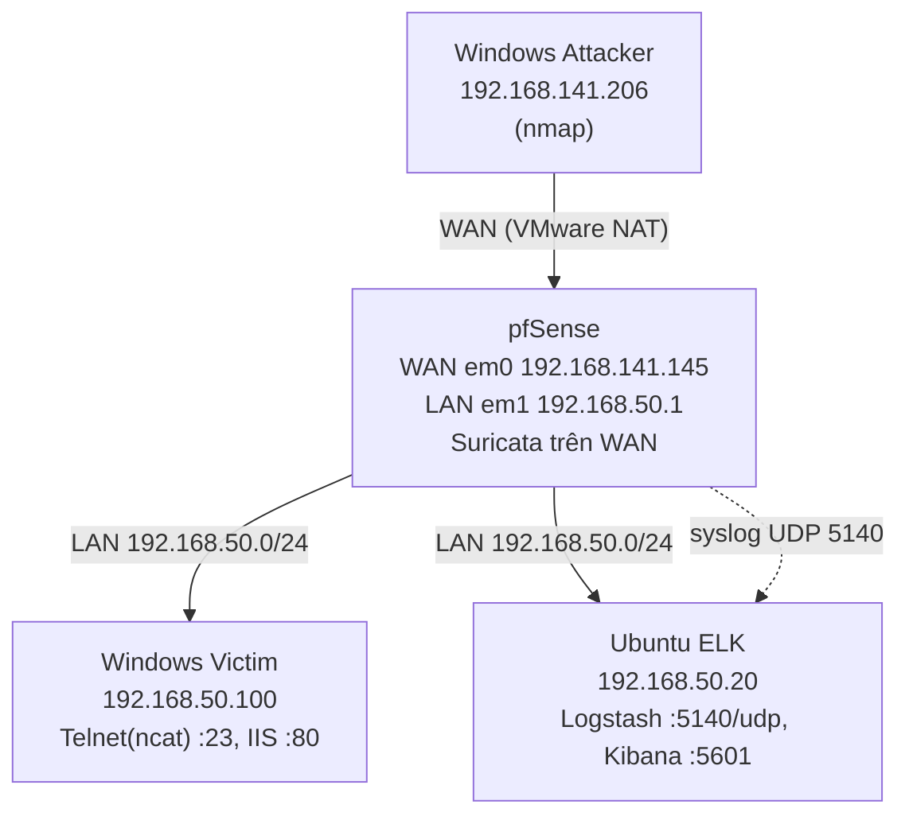

# Sơ đồ và quy hoạch IP

> Thay bằng ảnh xuất từ draw.io (`topology.png`) nếu muốn. Sơ đồ Mermaid dưới đây GitHub tự hiển thị.

## Bảng IP

| Thiết bị | Mạng | Địa chỉ |
|---|---|---|
| pfSense WAN (em0) | VMware NAT (VMnet8) | DHCP, ví dụ 192.168.141.145 |
| pfSense LAN (em1) | VMnet2 (LAN riêng) | 192.168.50.1/24 |
| Windows Victim | LAN | 192.168.50.100 (tĩnh) |
| Ubuntu ELK | LAN | 192.168.50.20/24 (tĩnh) |
| Windows Attacker | WAN | DHCP, ví dụ 192.168.141.206 |

## Mạng ảo (VMware)

| Mạng | Cấu hình | Dùng cho |
|---|---|---|
| VMnet8 | NAT | pfSense WAN, Attacker |
| VMnet2 | Host-only, tắt DHCP của VMware | pfSense LAN, Victim, ELK |

Lưu ý: nếu VMnet2 bật "Connect a host virtual adapter", máy thật có thể chiếm `.1` của dải và trùng IP LAN của pfSense. Tắt tuỳ chọn đó hoặc đổi IP card host.

## Cổng và dịch vụ

| Cổng | Dịch vụ | Nơi |
|---|---|---|
| 23/tcp | Telnet giả lập (ncat) | Victim, qua port forward từ WAN |
| 80/tcp | HTTP (IIS) | Victim, qua port forward từ WAN |
| 5140/udp | Logstash (syslog) | ELK |
| 5601/tcp | Kibana | ELK |
| 9200/tcp | Elasticsearch | ELK, chỉ `127.0.0.1` |
